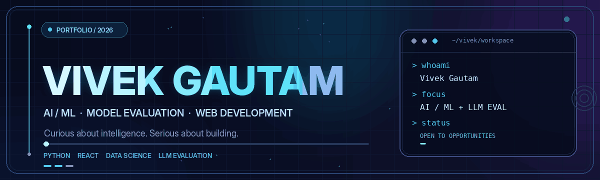
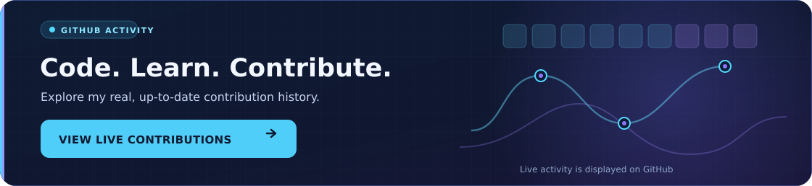

<!-- Premium GitHub profile README for @vivekgautam208 -->
<!-- Put README.md in the ROOT of github.com/vivekgautam208/vivekgautam208 -->
<!-- Keep assets/hero.gif in the same repository for the animated cover to work. -->

  

  

  
  
  
  
  

---

## ✦ About Me

I'm **Vivek Gautam**, a Computer Science and Engineering (B.Tech) developer from **IIIT Bhagalpur**, interested in creating useful software and understanding how intelligent systems perform in the real world.

- 🧠 **AI & LLMs:** Model evaluation, benchmark-oriented testing, response quality, and reliability.
- 📊 **Data & ML:** Data analysis, visualization, and machine learning with Python.
- 💻 **Development:** Responsive interfaces, practical web applications, and problem solving.
- 🔍 **What drives me:** Careful experiments, measurable improvements, and learning by building.
- 🤝 **Open to:** AI/ML, data science, model evaluation, and software development opportunities.

> **I enjoy building systems — and asking the right questions to understand how well they work.**

## ⚡ Areas of Interest

<table>
  <tr>
    <td width="33%" align="center" valign="top">
      <h3>🧠 AI / LLM Evaluation</h3>
      Benchmarking • Model quality • Reasoning analysis • Reliability
    </td>
    <td width="34%" align="center" valign="top">
      <h3>📈 Data & Machine Learning</h3>
      Python • Data workflows • Visualization • Experiments
    </td>
    <td width="33%" align="center" valign="top">
      <h3>🌐 Web Engineering</h3>
      React • JavaScript • Responsive design • User experience
    </td>
  </tr>
</table>

## 🛠️ Technology Toolkit

**Programming & machine learning**

  

**Web & application development**

  

**Databases & developer tools**

  

## 📂 Explore My Work

  

A few public projects and practice repositories:

| Project | Focus |
| :-- | :-- |
| [Myntra Clone](https://github.com/vivekgautam208/Myntra-Clone) | Front-end development practice |
| [LeetCode Daily](https://github.com/vivekgautam208/LeetCode_Daily) | Coding and algorithm practice |
| [Drum Play](https://github.com/vivekgautam208/Drum-Play) | Interactive HTML, CSS, and JavaScript |

## 📊 GitHub Activity

  
  

  

  

The real, continuously updated contribution calendar is shown on my GitHub profile. Click the panel to see it.

About GitHub statistics

The stats and streak cards above come from third-party providers, so they may occasionally be unavailable or delayed. The contribution panel is hosted in this repository and links directly to GitHub's own live calendar. Top-language statistics reflect repository code, **not** skill proficiency.

## 🤝 Let's Connect

I'm interested in collaborating on thoughtful **AI/ML**, **LLM evaluation**, **data science**, and **software engineering** work. If there's an opportunity where I can contribute, I'd love to hear about it.

  
  

Made with curiosity, code, and a commitment to keep learning. ✨

