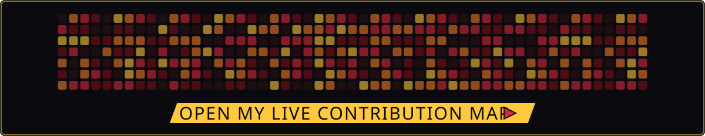

<!-- Comic-hero GitHub profile README for @vivekgautam208 -->
<!-- Put README.md in the ROOT of github.com/vivekgautam208/vivekgautam208 -->
<!-- Upload the whole assets/ folder to the same repository; every banner is an animated SVG. -->

  

  

  
  
  
  
  

 

  

Every hero has an origin story. Mine starts with a B.Tech in **Computer Science and Engineering at IIIT Bhagalpur**, where I got hooked on two things: building useful software, and understanding how intelligent systems actually behave in the real world.

- 🧠 **AI & LLMs:** Model evaluation, benchmark-oriented testing, response quality, and reliability.
- 📊 **Data & ML:** Data analysis, visualization, and machine learning with Python.
- 💻 **Development:** Responsive interfaces, practical web applications, and problem solving.
- 🔍 **What drives me:** Careful experiments, measurable improvements, and learning by building.
- 🤝 **Open to:** AI/ML, data science, model evaluation, and software development opportunities.

> I enjoy building systems — and asking the right questions to understand how well they work.

 

  

  

 

  

<table align="center">
  <tr>
    <td align="center" width="33%"><b>⚔️ Programming & ML</b></td>
    <td align="center" width="34%"><b>🛡️ Web & App Development</b></td>
    <td align="center" width="33%"><b>🧰 Databases & Dev Tools</b></td>
  </tr>
  <tr>
    <td align="center"></td>
    <td align="center"></td>
    <td align="center"></td>
  </tr>
</table>

 

  

A few public projects and practice repositories from the field:

| File | Mission | Focus |
| :---: | :--- | :--- |
| `#01` | [**Myntra Clone**](https://github.com/vivekgautam208/Myntra-Clone) | Front-end development practice |
| `#02` | [**LeetCode Daily**](https://github.com/vivekgautam208/LeetCode_Daily) | Coding and algorithm practice |
| `#03` | [**Drum Play**](https://github.com/vivekgautam208/Drum-Play) | Interactive HTML, CSS, and JavaScript |

  

 

  

  

  

  

The grid above is decorative. My real, continuously updated contribution calendar lives on my GitHub profile — click the panel to see it.

About these statistics

The language and streak cards come from third-party providers, so they may occasionally be unavailable or delayed. Top-language statistics reflect repository code, not skill proficiency.

 

  

I'm interested in collaborating on thoughtful AI/ML, LLM evaluation, data science, and software engineering work. If there's a mission where I can contribute, send the signal — I'd love to hear about it.

  
  

  

